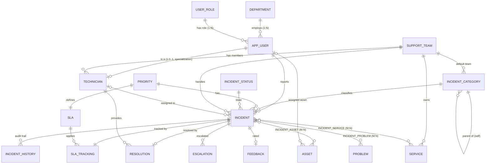

# IT Helpdesk & Incident Management Database — Design Document
**Course:** Database Management Systems (ETCCMS304) · **RDBMS:** MySQL 8.0.31+ · **NoSQL:** MongoDB

---
## 1. Problem statement & scope
Organizations track IT incidents through email/spreadsheets, causing duplicate tickets, wrong priority, wrong team assignment and SLA breaches. This system manages the full incident lifecycle — creation → categorisation → assignment → escalation → resolution → closure → feedback — with SLA monitoring, audit trail, problem (root-cause) management and RBAC.

**Objectives:** centralise tickets · apply business rules for priority/SLA · assign to teams/technicians · track SLA & escalations · keep complete history · link assets/services/problems · analytics · auditing & least-privilege security.

**Users:** End users (raise/track), Helpdesk agents (triage/resolve), Support teams, IT managers (SLA, workload), System administrators, Management.

## 2. Functional requirements
| ID | Requirement |
|----|-------------|
| FR1 | Create incident (auto ticket number, default team from category, SLA deadlines computed) |
| FR2 | Assign incident to a technician; record assignment history |
| FR3 | Track response and resolution SLA, mark breaches |
| FR4 | Escalate automatically/manually to Tier-2 (max 3 levels) |
| FR5 | Resolve with resolution code; close; collect feedback (1–5) |
| FR6 | Link incidents to assets, services and problems (M:N) |
| FR7 | Reports: open tickets, SLA breaches, technician workload, trends |
| FR8 | Audit log of status/assignment/priority changes |
| FR9 | Role-based access; injection-safe data access |
| FR10 | Activity feed / attachments / KB in MongoDB |

**Non-functional:** ACID consistency, concurrency safety, response time via indexes, auditability, least privilege.

## 3. Business rules
| BR | Rule | Enforced by |
|----|------|-------------|
| BR1 | Ticket number unique | `UNIQUE(ticket_no)`, `sp_create_incident` |
| BR2 | Every priority has an SLA; resolution time > response time | `sla` table, `CHK` |
| BR3 | SLA deadlines = created_at + SLA minutes; recalculated if priority changes | triggers `trg_incident_ai`, `trg_incident_au` |
| BR4 | A ticket is routed to the default team of its category | `incident_category.default_team_id` |
| BR5 | A ticket can have only one active technician; two agents cannot assign the same ticket | `SELECT … FOR UPDATE` in `sp_assign_incident` |
| BR6 | Cannot be closed unless Resolved; closed tickets are immutable | `trg_incident_bu` |
| BR7 | High/Critical ticket assigned after response SLA is breached is auto-escalated | `sp_assign_incident` + SAVEPOINT |
| BR8 | At most 3 escalation levels; no duplicate level per ticket | `uq_esc_level`, `sp_do_escalation` |
| BR9 | Feedback only after Resolved/Closed, rating 1–5 | `trg_feedback_bi`, `CHK` |
| BR10 | Only the assigned technician can resolve | `sp_resolve_incident` |
| BR11 | All status/assignment/priority changes are audited | `trg_incident_au` → `audit_log`, `incident_history` |
| BR12 | End users see only their own tickets; agents change data only via procedures | RBAC (file 07) |

## 4. ER / EER diagram
Render in <https://mermaid.live> or VS Code Mermaid preview, **or** (recommended for screenshot) run `01_schema.sql` then in **MySQL Workbench → Database → Reverse Engineer…** to auto-generate the EER diagram.

**Participation:** INCIDENT→APP_USER (reporter) total; INCIDENT→TECHNICIAN partial (unassigned tickets exist); INCIDENT→SLA_TRACKING total; INCIDENT→RESOLUTION/FEEDBACK partial.
**EER concepts:** *specialization* — TECHNICIAN is a specialization of APP_USER; *self-relationship* — INCIDENT_CATEGORY hierarchy; *associative entities* — three M:N link tables; AUDIT_LOG is an independent log entity.

## 5. Relational schema (22 tables)
| # | Table | PK | Important FKs / constraints |
|---|-------|----|-----------------------------|
| 1 | department | dept_id | UNIQUE dept_name |
| 2 | user_role | role_id | |
| 3 | app_user | user_id | dept_id, role_id; UNIQUE email; CHECK email |
| 4 | support_team | team_id | |
| 5 | technician | tech_id | user_id (UNIQUE), team_id |
| 6 | incident_category | category_id | parent_category_id (self), default_team_id |
| 7 | priority | priority_id | UNIQUE rank_level |
| 8 | incident_status | status_id | |
| 9 | sla | sla_id | priority_id UNIQUE; CHECK resolution>response |
| 10 | asset | asset_id | assigned_user_id; UNIQUE asset_tag |
| 11 | service | service_id | owner_team_id |
| 12 | incident | incident_id | reporter, category, priority, status, team, tech; UNIQUE ticket_no; CHECK dates |
| 13 | incident_history | history_id | incident_id, statuses, changed_by |
| 14 | sla_tracking | tracking_id | incident_id UNIQUE, sla_id |
| 15 | incident_asset | (incident_id, asset_id) | M:N |
| 16 | incident_service | (incident_id, service_id) | M:N |
| 17 | problem | problem_id | |
| 18 | incident_problem | (incident_id, problem_id) | M:N |
| 19 | escalation | escalation_id | UNIQUE(incident_id, escalation_level); CHECK level 1–3 |
| 20 | resolution | resolution_id | incident_id UNIQUE, tech |
| 21 | feedback | feedback_id | incident_id UNIQUE; CHECK rating 1–5 |
| 22 | audit_log | audit_id | — |

Sample data: **724 rows** (60 incidents, 258 history rows, 60 SLA rows, 46 resolutions, 29 feedback, 40 users, 30 assets …) generated reproducibly by `generate_data.py`.

## 6. Functional dependencies (derived from business rules)
- **department:** dept_id → dept_name, location; dept_name → dept_id
- **app_user:** user_id → full_name, email, phone, dept_id, role_id, is_active, created_at; email → user_id
- **technician:** tech_id → user_id, team_id, skill_level, is_active; user_id → tech_id
- **incident_category:** category_id → category_name, parent_category_id, default_team_id
- **priority:** priority_id → priority_name, rank_level
- **sla:** sla_id → sla_name, priority_id, response_minutes, resolution_minutes; priority_id → sla_id
- **asset:** asset_id → asset_tag, type, model, assigned_user_id, purchase_date, status; asset_tag → asset_id
- **incident:** incident_id → ticket_no, title, description, reporter_id, category_id, priority_id, status_id, team_id, assigned_tech_id, created/assigned/resolved/closed_at; ticket_no → incident_id
- **sla_tracking:** incident_id → tracking_id, sla_id, response_due, resolution_due, responded_at, breach flags
- **escalation:** escalation_id → all; (incident_id, escalation_level) → escalation_id
- **resolution / feedback:** incident_id → all other attributes
- **incident_asset / service / problem:** all-key relations (no non-trivial FD)

## 7. Normalization walk-through
### 7.1 Un-normalized relation (typical spreadsheet)
`INCIDENT_FLAT(incident_id, ticket_no, title, reporter_id, reporter_name, reporter_email, dept_id, dept_name, category_id, category_name, default_team_id, team_name, priority_id, priority_name, response_min, resolution_min, status_id, status_name, tech_id, tech_name, {asset_id, asset_tag, asset_type}, {service_id, service_name})`

**Key:** incident_id.

### 7.2 1NF — remove repeating groups
`{asset…}` and `{service…}` are multi-valued → move to `INCIDENT_ASSET(incident_id, asset_id, asset_tag, asset_type)` and `INCIDENT_SERVICE(incident_id, service_id, service_name)`. All attributes now atomic.

### 7.3 2NF — remove partial dependencies
In `INCIDENT_ASSET` (key = incident_id + asset_id): `asset_id → asset_tag, asset_type` is a **partial** dependency → split into `ASSET(asset_id, …)` and `INCIDENT_ASSET(incident_id, asset_id)`. Same for `SERVICE`.

### 7.4 3NF — remove transitive dependencies (in INCIDENT)
| Transitive dependency | Result |
|---|---|
| incident_id → reporter_id → reporter_name, email, dept_id | `APP_USER` |
| reporter_id → dept_id → dept_name | `DEPARTMENT` |
| incident_id → category_id → category_name, default_team_id | `INCIDENT_CATEGORY` |
| default_team_id → team_name | `SUPPORT_TEAM` |
| incident_id → priority_id → priority_name, response_min, resolution_min | `PRIORITY` + `SLA` |
| incident_id → status_id → status_name | `INCIDENT_STATUS` |
| incident_id → tech_id → tech_name, team | `TECHNICIAN` (+ `APP_USER`) |

Resulting `INCIDENT` keeps only the incident's own facts + foreign keys → **3NF**.
**Anomalies removed:** *update* (rename a department/priority once, not in 1000 tickets); *insertion* (add a new category/asset/technician without a ticket); *deletion* (deleting the last ticket no longer deletes asset/user information).

### 7.5 BCNF check
Every determinant in the final schema is a candidate key — e.g. `technician`: keys {tech_id}, {user_id}; `sla`: keys {sla_id}, {priority_id}; `incident`: keys {incident_id}, {ticket_no}; `escalation`: keys {escalation_id}, {incident_id, escalation_level} → **all tables are in BCNF**.

**Discussion example (3NF but not BCNF):** suppose we had stored `TECH_CAT(tech_id, category_id, team_id)` with FDs `{tech_id, category_id} → team_id` and `team_id → category_id` (a team handles exactly one category). Candidate keys: {tech_id, category_id} and {tech_id, team_id}. `team_id → category_id` violates BCNF (team_id is not a superkey) although it is 3NF (category_id is prime). Lossless, BCNF-compliant decomposition: `TEAM_CATEGORY(team_id, category_id)` + `TECH_TEAM(tech_id, team_id)` — which is exactly how the final schema stores it (technician.team_id and incident_category.default_team_id).

### 7.6 Controlled denormalisation (justified)
`sla_tracking` stores `response_due / resolution_due / breached` flags (derivable from incident + sla). Reason: SLA is a *point-in-time contract* — if the SLA table changes later, old tickets must keep their original deadlines; also speeds breach reports. Maintained by triggers.

## 8. Advanced-feature → business-rule map
| Feature | Solves |
|---|---|
| 4 triggers | SLA creation, history/audit, closure rules, feedback rule |
| 6 procedures | create, assign (SLA-aware + SAVEPOINT), resolve, escalate, cursor-based SLA monitor |
| 2 functions | `fn_sla_status`, `fn_avg_resolution_hours` |
| 6 indexes | open-ticket dashboards, technician workload, date-range trends, SLA scans, audit lookup |
| Transactions | assign/resolve/escalate atomicity; SAVEPOINT before escalation |
| Locking | two agents assigning the same critical ticket |
| RBAC | end user / agent / manager / admin |
| MongoDB | flexible activity feed, attachments metadata, KB |

## 9. Technology stack
MySQL 8 + Workbench · MongoDB 7 + Compass/mongosh · Python 3 + Flask + PyMySQL + PyMongo.
