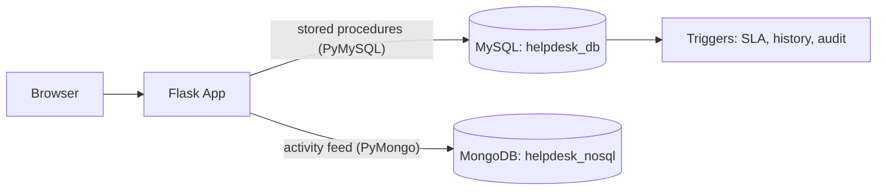

# IT Helpdesk & Incident Management System

> A database-centric IT service desk built with **MySQL 8**, **MongoDB** and **Python Flask**. It manages the complete incident lifecycle with SLA tracking, automatic escalation, audit logging, transactions, concurrency control and role-based security.


**Course:** Database Management Systems (ETCCMS304) - Capstone Project

---

## Table of Contents
1. [Overview](#overview)
2. [Key Features](#key-features)
3. [Architecture](#architecture)
4. [Database Highlights](#database-highlights)
5. [Business Rules](#business-rules)
6. [Project Structure](#project-structure)
7. [Getting Started](#getting-started)
8. [Using the Web App](#using-the-web-app)
9. [Security](#security)
10. [Testing](#testing)
11. [Screenshots](#screenshots)
12. [Author](#author)

---

## Overview

Organizations that track IT issues through email and spreadsheets suffer from duplicate tickets, wrong priorities, wrong team assignment and missed SLA deadlines. This project replaces that with a normalized relational database where the **business rules live inside the database itself** (constraints, triggers and stored procedures), so they cannot be bypassed by any client.

**Ticket lifecycle:** Create → Categorise → Assign → Escalate → Resolve → Close → Feedback

## Key Features

- **Automatic ticket creation:** unique ticket numbers (`INC-2026-00001`), routing to the category's default team
- **SLA engine:** response and resolution deadlines computed per priority and recalculated when priority changes
- **Smart assignment:** SLA-aware procedure with a `SAVEPOINT`; late High/Critical tickets are auto-escalated
- **Escalation:** manual or cursor-based automatic escalation to Tier-2 (maximum 3 levels)
- **Full audit trail:** every status, assignment and priority change is recorded in `incident_history` and `audit_log`
- **Problem management:** incidents link to assets, services and root-cause problems (M:N)
- **Concurrency safe:** row locking, conditional updates, optimistic locking and a deadlock demonstration
- **Least-privilege security:** four MySQL roles and a SQL-injection prevention demo
- **Hybrid storage:** activity feeds, attachments and knowledge-base articles in MongoDB
- **Web interface:** Flask dashboard for creating, assigning, escalating and resolving tickets

## Architecture



| Layer | Technology | Responsibility |
|---|---|---|
| Core data | MySQL 8 (InnoDB) | Tickets, SLA, assignment, escalation (ACID, FK, CHECK, triggers) |
| Flexible data | MongoDB | Comments, attachments, chat logs, KB articles |
| Application | Python, Flask, PyMySQL, PyMongo | Web UI; writes go through stored procedures only |

## Database Highlights

| Component | Details |
|---|---|
| Tables | 22 (3NF/BCNF), with PK, FK, UNIQUE and CHECK constraints |
| Sample data | 724 rows, reproducible via `generate_data.py` |
| Views | 4: open incidents, SLA breaches, technician workload, unresolved high priority |
| Indexes | 6 indexes, justified with `EXPLAIN` before/after on 20,000 rows |
| Triggers | 4: SLA creation, closure rules and history/audit, feedback rule |
| Procedures | 6: create, assign, resolve, escalate, internal escalation, cursor-based SLA monitor |
| Functions | 2: `fn_sla_status`, `fn_avg_resolution_hours` |
| Queries | 18+ sets using CTEs, window functions (`RANK`, `LAG`), set operations, self/cross/outer joins |

**EER concepts used:** specialization (Technician of App_User), self-relationship (category hierarchy), associative entities (three M:N link tables).

**Controlled denormalization:** `sla_tracking` stores deadlines so older tickets keep their original SLA even if the SLA table changes later.

## Business Rules

| Rule | Enforced by |
|---|---|
| Unique ticket number | `UNIQUE(ticket_no)`, `sp_create_incident` |
| Resolution time must exceed response time | `CHECK` on `sla` |
| Deadlines = created time + SLA minutes | Triggers on `incident` |
| One active technician per ticket | `SELECT ... FOR UPDATE` in `sp_assign_incident` |
| Closed tickets are immutable; close only after Resolved | `BEFORE UPDATE` trigger |
| Late High/Critical assignment auto-escalates | `sp_assign_incident` with `SAVEPOINT` |
| Maximum 3 escalation levels | `UNIQUE(incident_id, escalation_level)` |
| Feedback only after Resolved, rating 1-5 | Trigger and `CHECK` |
| Only the assigned technician can resolve | `sp_resolve_incident` |

Full requirements, ER diagram, functional dependencies and normalization walk-through are in [`00_design_document.md`](00_design_document.md).

## Project Structure

```
.
├── 00_design_document.md            Requirements, ER diagram, normalization
├── 01_schema.sql                    DDL: 22 tables
├── 02_data.sql                      Sample data (generated)
├── 03_views_indexes.sql             Views, indexes, EXPLAIN demo
├── 04_triggers_procs_functions.sql  Triggers, procedures, functions
├── 05_queries.sql                   Complex query set
├── 06_transactions_concurrency.sql  Transactions, locking, deadlock demo
├── 07_rbac_security.sql             Roles, users, SQL-injection demo
├── 08_test_cases.sql                Positive / negative / integrity tests
├── 09_mongodb_extension.js          MongoDB CRUD, indexes, aggregation
├── 10_app.py                        Original minimal Flask app
├── 11_sqli_demo.py                  Application-level SQL-injection demo
├── helpdesk_app.py                  Full web application
├── generate_data.py                 Reproducible sample data generator
└── README.md
```

## Getting Started

### Prerequisites
- MySQL **8.0.31+** (required for `INTERSECT` / `EXCEPT`) and MySQL Workbench
- Python 3.9+
- MongoDB 7 (optional, only for the activity feed)

### 1. Set up the database
Run the SQL files in MySQL Workbench **in this order** (use *Execute script*):

| Order | File |
|---|---|
| 1 | `01_schema.sql` |
| 2 | `02_data.sql` |
| 3 | `03_views_indexes.sql` |
| 4 | `04_triggers_procs_functions.sql` |
| 5 | `07_rbac_security.sql` (creates the `agent_aarav` account used by the app) |

Files `05`, `06` and `08` are demonstration scripts and can be run after that. Statements that are *meant to fail* should be run one at a time.

> If you see error 1418 on functions: `SET GLOBAL log_bin_trust_function_creators = 1;`

To regenerate the sample data: `python generate_data.py > 02_data.sql`

### 2. (Optional) Load MongoDB data
```bash
mongosh < 09_mongodb_extension.js
```

### 3. Run the web app
```bash
python -m pip install flask pymysql pymongo
python helpdesk_app.py
```
Open **http://127.0.0.1:5000**

## Using the Web App

| Page | Purpose |
|---|---|
| **Dashboard** | Status counts, create a ticket, search and list open tickets |
| **Ticket page** | History timeline, MongoDB activity feed, Assign / Escalate / Resolve actions |
| **SLA breaches** | Tickets that missed their resolution deadline |
| **Workload** | Open and resolved tickets per technician |

**Typical flow:** create ticket → open it → assign a technician (ID 1-10) → resolve with notes.

After creating a ticket you can verify the database side in Workbench:
```sql
SELECT * FROM incident          ORDER BY incident_id DESC LIMIT 1;
SELECT * FROM incident_history  ORDER BY history_id  DESC LIMIT 3;
SELECT * FROM sla_tracking      ORDER BY tracking_id DESC LIMIT 1;
SELECT * FROM audit_log         ORDER BY audit_id    DESC LIMIT 3;
```

## Security

| Role | Access |
|---|---|
| `role_end_user` | Own tickets through a view and one procedure; no table access |
| `role_agent` | Read operational views; modify data only through stored procedures |
| `role_manager` | Read everything including the audit log; no direct DML |
| `role_admin` | Full control of `helpdesk_db` only |

**SQL-injection defence in depth:** parameterised queries and prepared statements, stored procedures with a whitelisted `ORDER BY`, a least-privilege application account, input validation with `CHECK` constraints, and an audit log of changes. See `07_rbac_security.sql` (section 6) and `11_sqli_demo.py` for a vulnerable-versus-safe comparison.

> **Note:** The credentials in the SQL and Python files (for example `Agent@1234`) are **demo values for local use only**. Never reuse them in a real deployment.

## Testing

`08_test_cases.sql` covers:

- **Positive:** ticket creation, assignment, SLA recalculation, SLA status function
- **Negative / integrity:** invalid foreign key, duplicate ticket or e-mail, out-of-range rating, bad e-mail format, invalid SLA times, deleting a referenced parent row
- **Business rules:** closing before resolving, editing a closed ticket, early feedback, resolving by the wrong technician, duplicate escalation level
- **Transactions and concurrency:** rollback, savepoint, `FOR UPDATE` blocking, lost update prevention, deadlock (error 1213)

## Screenshots

> Add your screenshots to a `docs/screenshots/` folder and reference them here.

```markdown


```

## Author

**Your Name**
Roll No. / Course: ETCCMS304 - Database Management Systems
GitHub: [@your-username](https://github.com/your-username)
